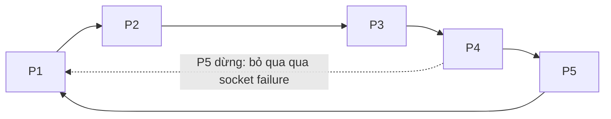

# Lab hệ thống phân tán: Ring Leader Election

Mô phỏng năm tiến trình logic P1-P5 bằng năm thread, mỗi node có socket TCP và trạng thái riêng. Node trao đổi thông điệp qua localhost để bầu ID lớn nhất đang hoạt động. Demo tự khởi động với P5 làm leader, dừng thread P5 và xác minh P1-P4 tự bầu P4.

## Chạy demo

Yêu cầu Python 3.12. Mã mô phỏng và kiểm thử chỉ dùng thư viện chuẩn, không cần `pip install`.

```powershell
py -3.12 -m leader_election --base-port 55000 --log-dir logs
```

Trên hệ điều hành khác, dùng `python3.12` thay cho `py -3.12`. Cần chạy từ thư mục chứa README này. Chương trình tự kết thúc sau khi P4 ổn định liên tục hai giây; mã thoát 0 nghĩa là PASS, 1 là FAIL, 130 là bị ngắt bằng Ctrl+C. Muốn giảm console output, thêm `--quiet`.

Nếu cổng 55000-55004 đang được dùng, đổi `--base-port` sang một dải năm cổng trống. Lỗi bind làm demo FAIL và đóng những node đã khởi động. Chỉ bind vào `127.0.0.1`; không cần cấu hình máy chủ ngoài.

## Theo dõi trace

`logs/trace.log` chứa trace dễ đọc; `logs/trace.jsonl` chứa từng sự kiện JSON với UTC, thời gian tương đối theo monotonic clock, node, loại sự kiện, nguồn/đích và vòng bầu cử. Lần chạy mới ghi đè hai file này; dùng `--log-dir` khác để giữ mỗi lần thực nghiệm.

Các sự kiện cần kiểm tra:

1. `READY`: năm listener đã bind thành công.
2. `ELECTION_START` với lý do `bootstrap`: P1 khởi xướng.
3. `ELECTION_COLLECTED`: thu đủ ID 1-5, chọn P5.
4. `ROUND_COMPLETE` và `BOOTSTRAP_COMPLETE`: thông báo leader đã đi hết vòng trước khi gây lỗi.
5. `STOPPED` của P5, rồi `CRASH`: P5 không còn thread hoặc socket; không có thông báo lỗi tới survivor.
6. `FAILURE_TIMEOUT`: node tự phát hiện thiếu heartbeat của P5.
7. `SEND_FAILED` và `BYPASS` tại P4: gửi P5 thất bại, thử P1.
8. `ELECTION_COLLECTED` chọn P4, các `COORDINATOR` hoàn tất, rồi `PASS` với leader của P1-P4 đều là 4.

Ví dụ vòng P2 sau crash: `P2 -> P3 -> P4 -> (P5 lỗi, bỏ qua) -> P1 -> P2`, danh sách `[2,3,4,1]`. Vòng thông báo đi theo cùng chiều. ID vòng như `P2:1` là người khởi xướng và bộ đếm cục bộ, không phải epoch toàn cục. Nhiều vòng có thể xen kẽ; thứ tự các dòng giữa thread không cố định.

`round_message_counts` trong sự kiện PASS đếm số frame `ELECTION`/`COORDINATOR` thực sự nhận được theo từng vòng, không tính heartbeat hay lần gửi thất bại. Vòng ban đầu có 10 lượt; một vòng sau crash có 8 lượt. Bốn vòng đồng thời có 32 lượt tổng cộng.

## Kiến trúc

| Thành phần | Trách nhiệm |
|---|---|
| `leader_election.protocol` | Định dạng JSONL, kiểm tra frame, tích lũy ID, chọn max và thứ tự successor |
| `leader_election.transport` | TCP không chặn, selector, connect/write/read từng phần và deadline |
| `leader_election.node` | Một thread/node, trạng thái riêng, các vòng Ring, heartbeat và watchdog |
| `leader_election.runner` | Khởi động, quan sát snapshot, dừng P5 và đánh giá kết quả |
| `leader_election.trace` | Ghi record nguyên dòng an toàn giữa thread và đếm thông điệp |



Các node chỉ chia sẻ cấu hình ID/địa chỉ và bộ ghi log. Trạng thái leader, timer, bộ đếm, vòng đang tham gia nằm riêng trong thread. Runner đọc bản sao snapshot có khóa để đánh giá; node không đọc snapshot của peer. Không có biến leader chung hoặc queue thay thế đường truyền socket.

Mỗi lần gửi mở một kết nối TCP ngắn với một frame JSON kết thúc bằng newline. Frame tối đa 8 KiB. TCP write thành công chỉ cho biết dữ liệu đã được giao cho ngăn xếp TCP; phép đếm thông điệp dùng sự kiện RECV của node đích. V1 giả định các node sống tiếp tục xử lý I/O đúng thời hạn.

Ring dùng danh sách ID theo giáo trình, không phải token ring mutual exclusion hoặc Chang-Roberts. Origin chuyển ELECTION trở về thành COORDINATOR, chọn `max(participants)`. Mỗi thông báo vẫn được chuyển đủ một vòng ngay cả khi leader đã được biết từ vòng khác.

## Timer mặc định

| Tham số | Giá trị | Ý nghĩa |
|---|---:|---|
| Heartbeat | 0,5 s | Leader gửi trực tiếp tới thành viên theo cấu hình |
| Failure timeout | 2 s | Follower khởi xướng khi thiếu heartbeat của leader đã chấp nhận |
| Socket deadline | 0,4 s | Tổng thời gian một lần connect và write; chuyển sang successor tiếp theo khi thất bại |
| Election watchdog | 5 s | Origin chưa hoàn tất vòng thông báo thì tạo vòng mới |
| Giới hạn demo | 15 s | Thời hạn tính từ lúc P5 đã dừng |
| Cửa sổ ổn định | 2 s | Survivor cùng nhận P4 và các vòng đang tham gia đã hoàn tất |

Timer dùng `time.monotonic()`. Đây là lựa chọn triển khai cho localhost, không phải hằng số của thuật toán trong giáo trình. Listener cùng sẵn sàng trước khi bầu ban đầu; không báo crash trước khi thông báo P5 đi hết vòng. Socket của node chết vẫn có thể được thử trong các vòng sau vì không có registry sống/chết tập trung.

## Kiểm thử

```powershell
py -3.12 -m unittest discover -s tests -v
py -3.12 tools/verify.py
py -3.12 tools/stress_demo.py --runs 20 --base-port 55100 --output logs/stress
```

`tools/verify.py` chạy cùng bộ unittest và lưu kết quả vào `logs/verification/`. Stress dùng timer mặc định, cửa sổ ổn định hai giây và tái sử dụng cùng dải cổng; mỗi lần có thư mục log riêng, kết quả tổng hợp ở `logs/stress/summary.json`.

Kiểm thử bao phủ: giao thức, max ID, wrap-around, vòng độc lập, socket thật, bypass P5, bốn node cùng hết hạn heartbeat, watchdog retry, frame chia nhỏ/sai/quá dài, partial write, không có election giả trong 10 giây khỏe, rollback khi cổng bận, dọn thread khi Ctrl+C và chạy lại cùng cổng. Phần lớn kiểm thử dùng timer ngắn; stress và kiểm thử trạng thái khỏe dùng cấu hình mặc định.

## Báo cáo và giới hạn

Báo cáo hai trang: `output/pdf/bao_cao_kien_truc_ring.pdf`. Nội dung chỉnh sửa được ở `docs/bao_cao_kien_truc.md`; hai vị trí `{{trace}}` và `{{evidence}}` được script `tools/build_report.py` thay bằng số liệu trực tiếp từ demo, unittest và stress. Bản Markdown đã điền số liệu nằm ở `output/pdf/bao_cao_kien_truc.md`. Script yêu cầu `reportlab`, `pypdf` và font hỗ trợ tiếng Việt; các thư viện này chỉ phục vụ tạo báo cáo, không ảnh hưởng mã mô phỏng.

```powershell
py -3.12 -m pip install -r requirements-report.txt
py -3.12 tools/build_report.py
```

Một vòng với m node sống cần 2m lượt chuyển thành công; k người khởi xướng độc lập cần 2km. Nếu k tăng tới m, chi phí thông điệp là O(m²). Danh sách ID tăng theo m nên số thông điệp và lượng dữ liệu là hai đại lượng khác nhau.

V1 giả định thành viên cố định, localhost, P5 crash-stop sau bootstrap và P1-P4 tiếp tục hoạt động/liên lạc trong lúc bầu lại. Timeout biểu thị nghi ngờ lỗi. Không đặc tả recovery, partition, thay đổi thành viên hay crash giữa vòng; không đưa ra bảo đảm leader duy nhất trong mạng bị phân hoạch.

## Tài liệu tham khảo

- `Lect04_processes_and_coordination.pdf`: slide 25-26 về Ring; slide 32-33 về yêu cầu và rubric.
- Tanenbaum & van Steen, *Distributed Systems: Principles and Paradigms*, 2nd edition: §6.5.1, trang sách 266 (PDF 285), Ring có danh sách ID và nhiều initiator; §8.2.4, trang 335-336 (PDF 354-355), phát hiện lỗi; §3.1, process/thread; §4.3.1, socket TCP.
