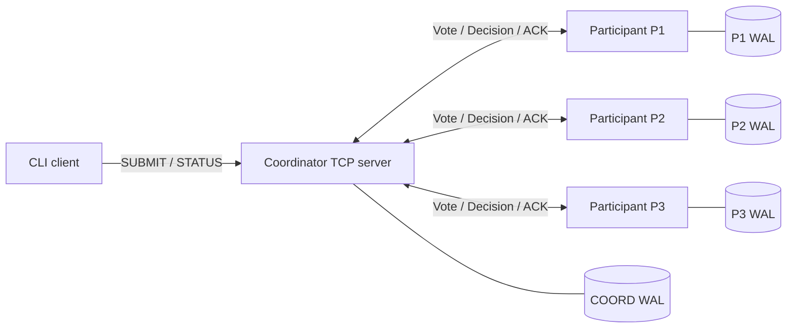
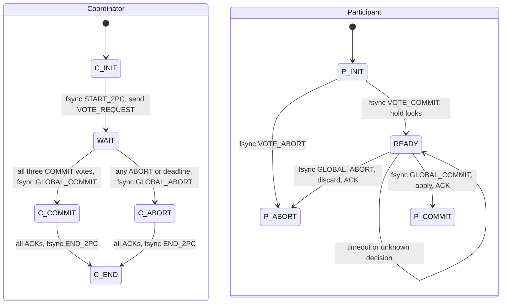

# Báo cáo thiết kế: 2PC Simulator

## 1. Mục tiêu và căn cứ giáo trình

Bài lab triển khai atomic commit trên một coordinator và ba participant dùng
TCP socket. Bốn server chạy bằng bốn tiến trình độc lập. Mỗi participant có dữ liệu
key-value riêng; tất cả cùng commit hoặc cùng abort một giao dịch phân tán.

Nguồn sử dụng trong thư mục dự án:

1. **Lect05_transactions_and_fault_tolerance.pdf**: trang 6–7 mô tả WAL và thứ tự
   append/flush/fsync; trang 29–31 mô tả 2PC và state machine; trang 32 quy định
   recovery; trang 33 và 37 phân tích blocking; trang 53–54 là đề lab và rubric.
2. **Distributed systems principles and paradigms 2nd edition.pdf**, mục **8.5.1**,
   trang in **355–360**, tương ứng trang PDF **374–379**. Hình 8-18 mô tả state
   machine, Hình 8-19 nêu xử lý READY khi hỏi peer, Hình 8-20/8-21 trình bày thuật toán.

Chính sách recovery của dự án theo slide 32: coordinator có START nhưng chưa có
quyết định sẽ abort sau restart. Sách trang in 358 cũng đề cập khả năng gửi lại
vote request; dự án chọn một chính sách duy nhất. Sách trang in 357 cho phép cách
đơn giản là participant chờ coordinator phục hồi; đây là phương án được triển khai.

Phần checkpoint, optimistic message logging, 3PC và consensus giúp đặt bối cảnh,
nhưng không phải yêu cầu triển khai của lab này. WAL ở đây ghi trạng thái/giao dịch,
không ghi toàn bộ thông điệp mạng như một hệ thống message logging tổng quát.

## 2. Kiến trúc và trách nhiệm



- Coordinator quản lý membership cố định P1/P2/P3, thu phiếu, quyết định và thu ACK.
- Participant kiểm tra khả năng chuẩn bị, giữ khóa, giữ cập nhật pending và xử lý quyết định.
- WAL là nguồn dữ liệu bền vững; store trong RAM được dựng lại khi mở node.
- CLI gửi yêu cầu; harness tạo/kill/restart tiến trình và kiểm tra trạng thái qua TCP.

Node không đọc file của node khác. Harness/test có thể đọc WAL để xác minh bằng
chứng, nhưng không dùng file đó để quyết định thay cho giao thức.

Mỗi node dùng một event loop `asyncio`. Các đoạn ghi WAL và đổi trạng thái không
chứa `await`, nên không có handler khác xen vào giữa hai thao tác. Các chờ mạng
đều nằm ngoài đoạn chuyển trạng thái. `fsync` cố ý đồng bộ và có thể tạm chặn event
loop; đây là đánh đổi phù hợp với simulator nhỏ để làm rõ durability.

Coordinator chỉ cho phép một giao dịch chưa đủ ACK. Nhiều thao tác SET trong một
participant vẫn được chuẩn bị/áp dụng theo cùng một quyết định. Khóa key thực tế
được giữ tới quyết định cuối; tùy chọn `--lock-key` tạo xung đột bên ngoài để demo.

## 3. Giao thức và state machine

Mỗi RPC là một JSON UTF-8 kết thúc bằng newline trên một kết nối TCP, tối đa 1 MiB.
TCP là byte stream: `readline` gom đủ frame dù dữ liệu đến thành nhiều phần.
Envelope có `type`, `sender`, và `tx_id` khi liên quan giao dịch. ID là chuỗi không rỗng,
tối đa 128 ký tự. Payload chuẩn hóa được băm SHA-256 để phát hiện tái dùng ID với
nội dung khác; fingerprint không đóng vai trò xác thực mật mã.

Payload SUBMIT/VOTE_REQUEST là `operations`, chứa đúng P1/P2/P3. Mỗi nhóm là danh
sách SET, key không rỗng tối đa 256 ký tự, value là số nguyên (không chấp nhận boolean),
không trùng key trong một nhóm. Coordinator gửi toàn bộ payload để mỗi node tự kiểm
tra fingerprint và lấy phần thao tác của mình.



INIT/WAIT/READY/COMMIT/ABORT là trạng thái giao thức. `END_2PC` là dấu hoàn tất quản
lý tại coordinator, không phải pha commit thứ ba. Participant có thể đã local abort
từ VOTE_ABORT nhưng vẫn ghi GLOBAL_ABORT và trả ACK khi nhận quyết định toàn cục.

Điều kiện commit kiểm tra **đúng tập P1/P2/P3** và cả ba phiếu là VOTE_COMMIT; không
dùng riêng `all(votes.values())`, vốn có thể trả đúng trên tập rỗng hoặc thiếu phiếu.
Mỗi task thu phiếu tương ứng một participant, kiểm tra sender, ID và fingerprint.
Phiếu không hợp lệ không được tính; thiếu phiếu cuối cùng dẫn tới timeout abort.

Hạn bỏ phiếu 5 giây được tính chung bằng đồng hồ monotonic. Ba yêu cầu chạy đồng
thời và retry lỗi mạng trong hạn này; không chờ lần lượt ba hạn độc lập. Phiếu abort
cho phép quyết định sớm. Nếu quyết định đã bền vững, timeout ACK chỉ dẫn đến retry.

Client STATUS phân biệt `decision` và `completed`. Một giao dịch có thể đã COMMIT
bền vững trong khi một participant còn READY; coordinator tiếp tục phát quyết định.
Không thông báo hoàn tất toàn cụm cho tới khi có đủ ACK và END_2PC bền vững.

## 4. Stable storage và phục hồi

Mỗi WAL là JSON Lines với các trường `seq`, `event`, `tx_id`, `data`. Số thứ tự phải
liên tục từ 1. META ở đầu log ràng buộc node, membership và dữ liệu ban đầu.

| Vai trò | Record | Nội dung chính |
|---|---|---|
| COORD | START_2PC | Toàn bộ operations, fingerprint, danh sách participant |
| COORD | GLOBAL_COMMIT / GLOBAL_ABORT | Quyết định, fingerprint, lý do, các phiếu đã thu |
| COORD | END_2PC | Đã nhận đủ ACK |
| Participant | INIT | Operations cục bộ và fingerprint |
| Participant | VOTE_COMMIT | Operations đủ để phục hồi pending và khóa |
| Participant | VOTE_ABORT | Lý do từ chối |
| Participant | GLOBAL_COMMIT / GLOBAL_ABORT | Quyết định và fingerprint |

Thứ tự bắt buộc:

```text
append record -> flush -> fsync -> change state/apply data -> send response
```

Commit không ghi đè store trước khi có quyết định bền vững. Abort không cần undo
dữ liệu committed vì cập nhật chưa được áp dụng. Khi replay, INIT/VOTE_COMMIT khôi
phục ý định; GLOBAL_COMMIT áp dụng SET theo thứ tự log. END_2PC giúp coordinator
khôi phục kết quả hoàn tất. ACK riêng lẻ chưa được lưu; nếu crash trước END, coordinator
gửi lại quyết định tới cả ba và thu lại ACK. Participant nhận quyết định trùng chỉ ACK,
không ghi thêm terminal record hay áp dụng dữ liệu lần nữa.

Nếu append/flush/fsync lỗi, WAL bị đánh dấu không thể ghi tiếp; server dừng với mã 74.
Không trả lời thành công từ trạng thái chưa chắc bền vững. Sau lỗi fsync, record có
thể vẫn xuất hiện trên đĩa; recovery dùng phần log hợp lệ thực sự còn lại, không suy
luận rằng giao dịch đã abort chỉ vì client mất phản hồi.

Đuôi cuối không có newline bị bỏ và truncate trước append tiếp theo. Record đã kết
thúc bằng newline nhưng không hợp lệ, sequence sai, fingerprint mâu thuẫn hoặc
chuyển trạng thái trái phép khiến startup dừng. Kiểm tra này phát hiện lỗi cấu trúc
và mâu thuẫn giao thức; không cung cấp checksum chống mọi dạng bit flip trên đĩa.

| Trạng thái durable sau crash | Recovery |
|---|---|
| COORD START, chưa quyết định | Fsync GLOBAL_ABORT, phát quyết định |
| COORD đã quyết định, chưa END | Phát lại cùng quyết định, thu lại ACK |
| COORD đã END | Trả kết quả cũ cho STATUS/SUBMIT trùng |
| Participant INIT, chưa vote | Fsync VOTE_ABORT |
| Participant READY | Khôi phục khóa và pending, hỏi coordinator |
| Participant đã quyết định | Replay dữ liệu; nhận lại thông điệp và ACK |

GLOBAL_ABORT cho giao dịch chưa biết tạo một tombstone bền vững: prepare đến muộn
không thể tạo lại READY. GLOBAL_COMMIT cho giao dịch chưa READY bị từ chối. Terminal
decision không thể đảo ngược; duplicate request cùng ID khác payload bị từ chối.

READY không tự abort khi timeout. Nếu coordinator trả UNKNOWN, chưa có quyết định
hoặc không liên lạc được, participant tiếp tục giữ khóa và chờ. Tất cả participant
cùng READY vẫn không có quyền tự commit: chưa có quyết định coordinator. Kịch bản
blocking không cần thêm một participant chết nếu mọi participant liên lạc được
đều ở READY; trường hợp coordinator và một participant cùng chết trong slide là
một tình huống minh họa khác của cùng hạn chế.

## 5. Kiểm thử, tiêu chí và đối chiếu rubric

Lệnh kiểm thử duy nhất:

```powershell
python -m unittest discover -s tests -v
```

Unit test kiểm tra fsync trước thay đổi state/store, WAL bị lỗi, đuôi ghi dở,
replay READY/INIT/COMMIT, metadata, transition mâu thuẫn, vote thiếu và validation.
TCP test kiểm tra frame chia nhỏ, UTF-8, frame quá lớn, thiếu newline và đóng kết
nối sau timeout. Integration test chạy cụm thật trên cổng riêng và WAL tạm riêng.

Các integration scenario gồm commit, lock abort, mất vote, mất ACK, crash trong
INIT/READY, crash coordinator trước quyết định/sau quyết định/sau gửi một node,
crash participant trước áp dụng dữ liệu và restart toàn cụm. Các test bổ sung kiểm
tra BUSY, ID trùng, quyết định trái ngược, tombstone và khóa key thực tế.

Failpoint crash dùng `os._exit(86)` sau record đã fsync; không chạy cleanup giao dịch.
Restart giữ nguyên WAL và bỏ tham số injection. Điều kiện đồng bộ là PING, STATUS,
exit code hoặc nội dung WAL, với deadline; không giả định máy xử lý xong sau một
chuỗi sleep cố định. Test blocking liên tục quan sát READY và GET qua nhiều chu kỳ retry.

| Rubric | Bằng chứng trong dự án |
|---|---|
| 2PC & FSM 40% | nodes/state; đủ ba vote, timeout, ACK, duplicate, khóa và blocking test |
| WAL 30% | wal; fsync gate, replay data/pending/locks, log corrupt/torn-tail tests |
| Failure/recovery 20% | harness; tiến trình crash thật, restart WAL cũ, 10 demo scenario |
| Documentation 10% | README, báo cáo này, trace mẫu và hướng dẫn demo |

Bất biến: không có COMMIT và ABORT ở hai participant cho cùng giao dịch; commit
đòi đủ ba phiếu; mọi cam kết có log bền vững trước phản hồi; READY không tự quyết;
sau recovery và khi mạng hoạt động, quyết định cuối được phát đến đủ ba node.

### Kết quả xác minh thực tế

Môi trường xác minh: Windows, Python 3.11.15, thư viện chuẩn. Bộ test hiện có **36
ca**: 16 integration test, 3 TCP framing test và 17 WAL/state test.

| Lần xác minh | Kết quả |
|---|---|
| `python -m unittest discover -s tests -v` trước khi bổ sung ca nhiều key | 35 test, OK |
| `python -m unittest tests.test_storage_and_state -v` sau khi bổ sung ca nhiều key và hoàn thiện STATUS UNKNOWN | 17 test, OK |
| CLI demo `all-commit` | GLOBAL_COMMIT, completed=true |
| CLI demo `vote-abort` | GLOBAL_ABORT, completed=true |
| CLI demo `coordinator-wait-crash` | Giữ READY khi coordinator chết; recovery GLOBAL_ABORT, completed=true |

Các lần kiểm thử bao phủ đủ 36 ca khác nhau của phiên bản bàn giao. Test nhiều key
chứng minh dữ liệu từ giao dịch commit trước vẫn còn sau một giao dịch abort và
replay; phản hồi STATUS cho giao dịch chưa biết vẫn giữ tx_id được yêu cầu.

## 6. Giới hạn và kết luận thiết kế

Mô hình là process crash/recovery, một ổ đĩa còn dữ liệu sau crash và một instance
cho mỗi danh tính. `fsync` là ranh giới stable storage trong mô hình lab; dự án không
mô phỏng mất ổ đĩa, RAID hoặc lỗi Byzantine. Các RPC dùng sender để kiểm tra vai trò
trong môi trường tin cậy; không có TLS hay xác thực đối tác.

2PC bảo đảm atomic commit, không tự cung cấp mọi tính chất ACID của một database.
GET chỉ đọc local committed state, không phải distributed snapshot. Các node có
thể đổi sang COMMIT tại các thời điểm khác nhau; READY trong giai đoạn truyền quyết
định là hợp lệ. Không có bầu coordinator mới hoặc peer termination protocol, nên
availability phụ thuộc coordinator phục hồi. Demo blocking được xem là kết quả đúng.
